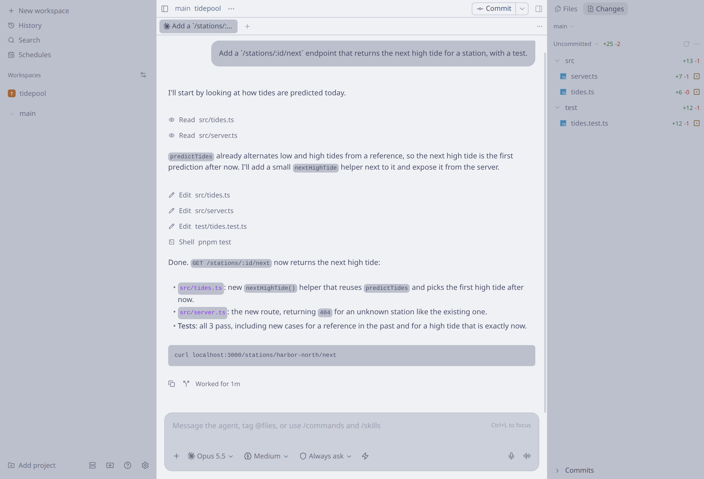
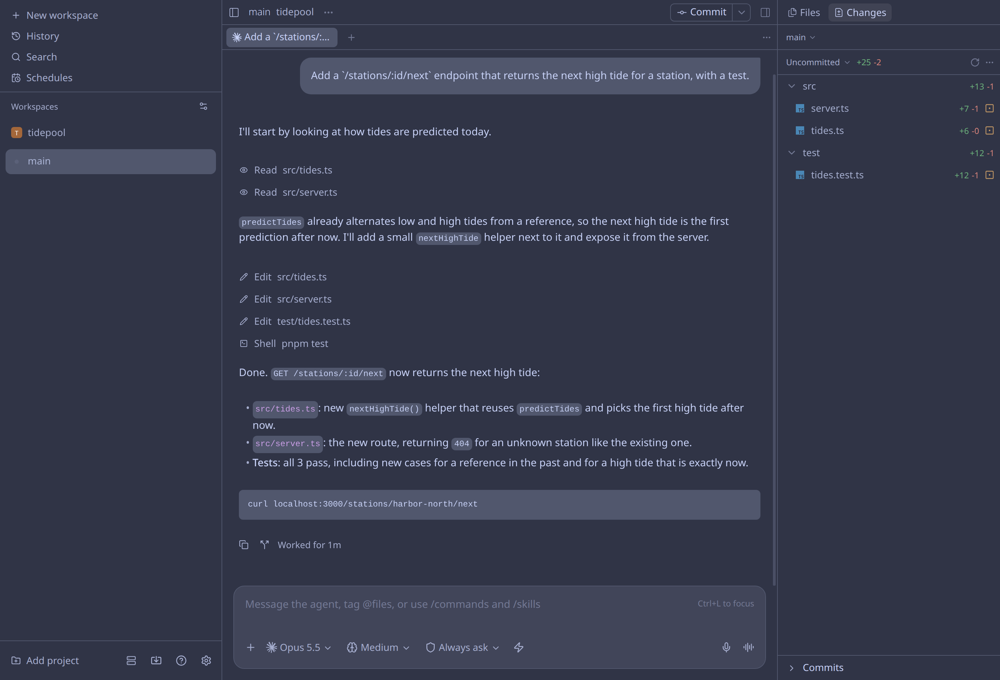
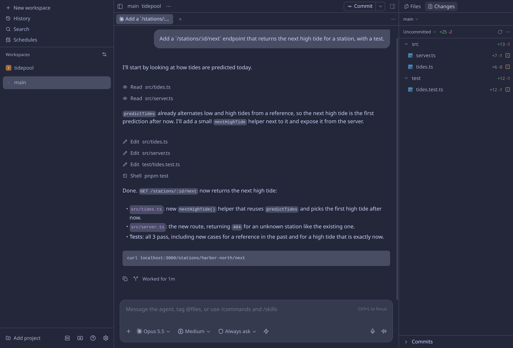
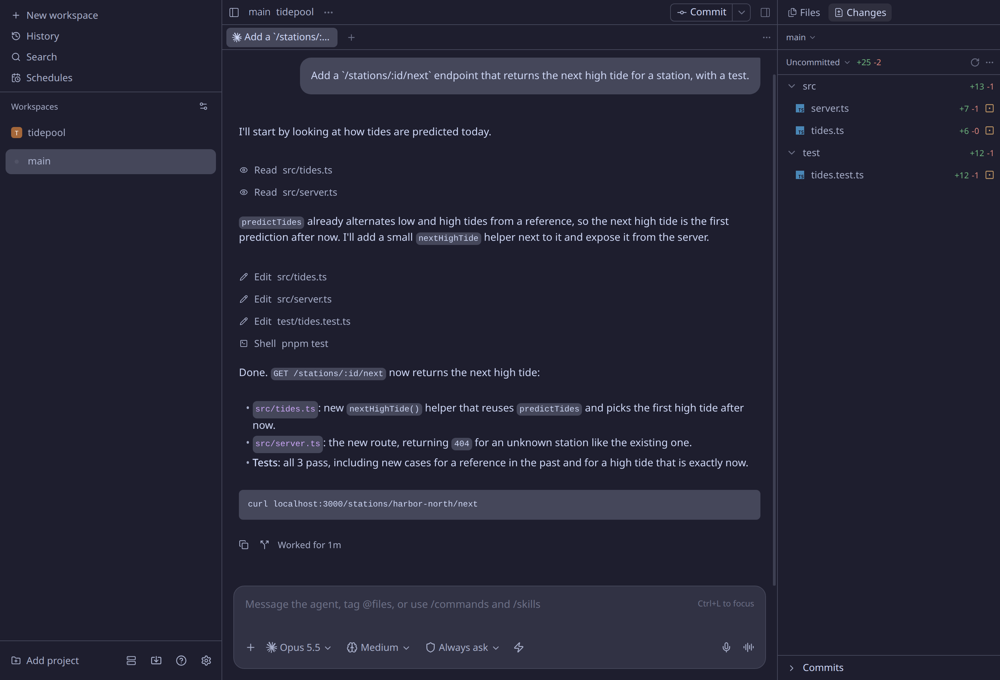

# Catppuccin theme

[](https://paseo.cafe/plugins/catppuccin-theme)

Adds the four [Catppuccin](https://catppuccin.com/palette/) flavours to Paseo as app themes: Latte, Frappé, Macchiato and Mocha.

## Screenshots









## Installation

Requires Paseo 0.9 or newer.
Install from the [Paseo plugin registry](https://paseo.sh/plugins), which needs Paseo 0.11 or newer:

```sh
paseo plugin add sleeyax/catppuccin-theme
```

Or install from this repository's default branch:

```sh
paseo plugin add github:sleeyax/paseo-plugins:plugins/catppuccin-theme
```

Update with `paseo plugin update catppuccin-theme`.

## Usage

Pick a flavour under **Settings → Appearance**.
The themes recolour the app only; syntax highlighting keeps its own theme.

## Development

```sh
pnpm --filter @paseo-plugins/catppuccin-theme typecheck
pnpm --filter @paseo-plugins/catppuccin-theme test
paseo plugin reload catppuccin-theme
paseo plugin logs catppuccin-theme
```

## License and attributions

The palettes come from [Catppuccin](https://github.com/catppuccin/catppuccin), licensed under the MIT License.
