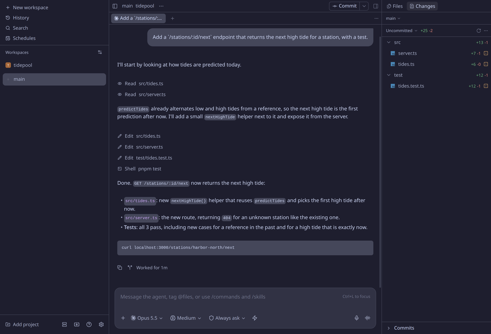
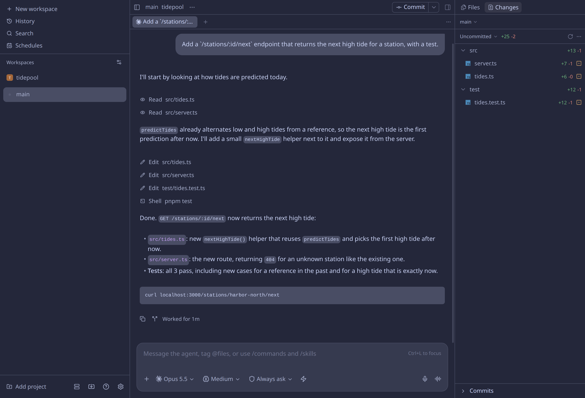
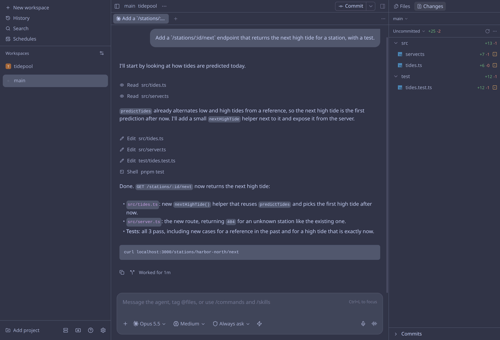
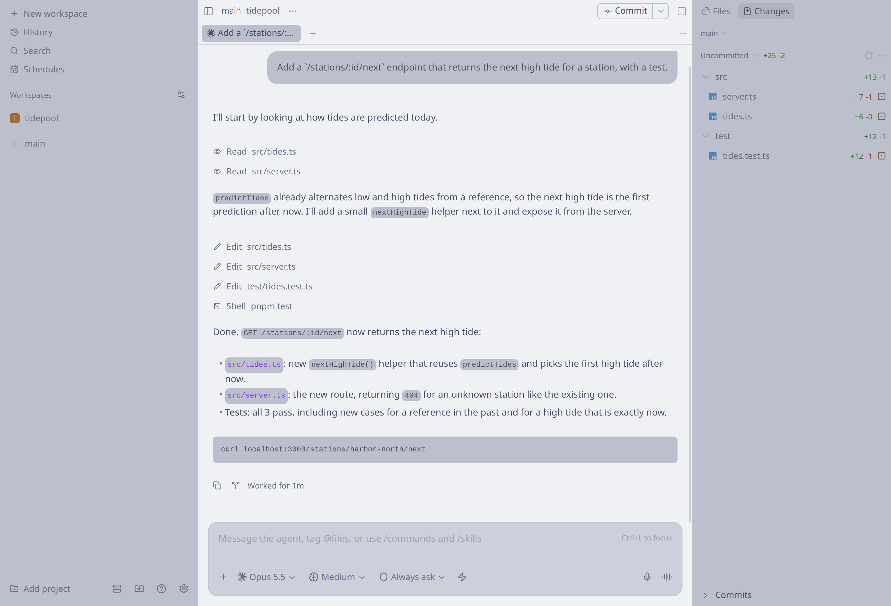

# Catppuccin theme

Adds the four [Catppuccin](https://catppuccin.com/palette/) flavours to Paseo as app themes: Latte, Frappé, Macchiato and Mocha.

## Screenshots









## Installation

Requires:

- Paseo 0.16 or newer

```sh
paseo plugin add github:sleeyax/paseo-plugins:plugins/catppuccin-theme
```

Also available as `sleeyax/catppuccin-theme` on [Paseo Community Plugins](https://paseo.sh/plugins).
You can also install it from **Settings → Host → Plugins → Browse**.

Update with `paseo plugin update catppuccin-theme`.
To install from source, see the [root README](../../README.md#from-source).

## Usage

Pick a flavour under **Settings → Appearance**.
The themes recolour the app only; syntax highlighting keeps its own theme.

## Development

For development instructions, see the [root README](../../README.md#development).

## License and attributions

The palettes come from [Catppuccin](https://github.com/catppuccin/catppuccin), licensed under the MIT License.
