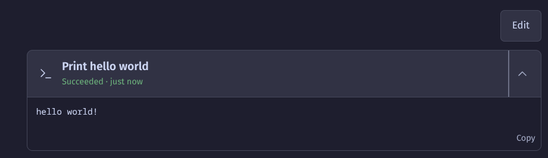
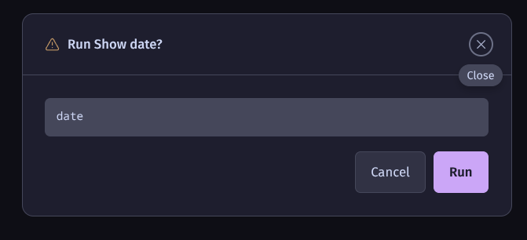
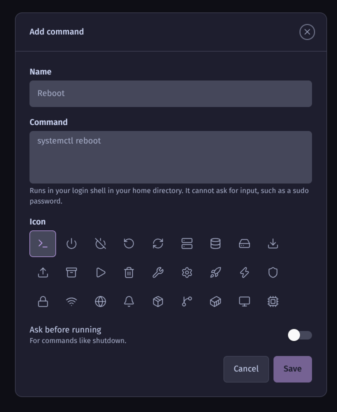

# Quick Commands

Save a shell command once, such as rebooting the host or restarting a service, and run it on the host with one tap.
It works the same from a phone, without opening a terminal or asking an agent.

## Screenshots







## Installation

Requires:

- Paseo 0.16 or newer
- A macOS or Linux host

```sh
paseo plugin add github:sleeyax/paseo-plugins:plugins/quick-commands
```

Update with `paseo plugin update quick-commands`.
To install from source, see the [root README](../../README.md#from-source).

## Usage

### Add a command

Open **Quick Commands** in the sidebar and select **Add command**.
Give it a name and the command, and optionally an icon.
Turn on **Ask before running** for commands like shutdown.

Commands are saved on the host, so every device connected to it sees the same list.
With several hosts, switch between their lists with the host picker in the screen's header.

### Run a command

Tap a command on the **Quick Commands** screen, or choose **Run: <name>** in the Command Center.
Its status shows under its name, and the arrow on the right shows the last 200 lines of its output.
A running command has a stop button, which ends the command and anything it started.

A command can't run twice at the same time, but different commands can run side by side.
A command that takes the host down, such as a reboot, shows as **Interrupted** once the host is back, because its outcome is unknown.

### Edit, reorder or delete commands

Select **Edit** on the screen.
Use the arrows to reorder commands, and tap a command to change or delete it.
Editing or deleting a running command does not stop it.

### How commands run

A command runs on the host as the user running Paseo, in your login shell, starting in your home directory.
The shell reads your profile files (`.profile`, `.bash_profile`, `.zprofile`) but not `.bashrc` or `.zshrc`.
If a tool is missing from `PATH`, move the line that adds it to your profile file.

A command can't read input.
Anything that asks for a password, such as `sudo`, fails right away instead of waiting.
On many Linux desktops `systemctl poweroff` and `systemctl reboot` work without `sudo`.
Otherwise, allow the command without a password, for example in `/etc/sudoers.d/quick-commands`:

```sudoers
your-user ALL=(root) NOPASSWD: /usr/bin/systemctl restart nginx
```

## Development

For development instructions, see the [root README](../../README.md#development).

Design decisions are in [docs/adr](docs/adr).
