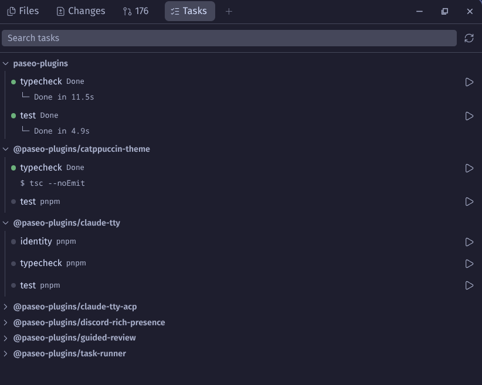
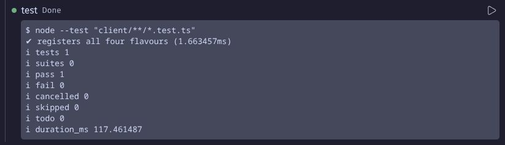
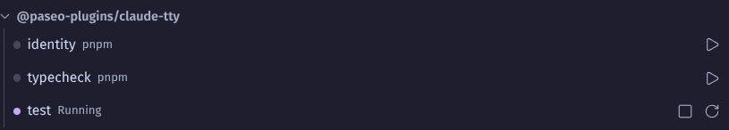

# Task Runner

Run the scripts your project already defines from a **Tasks** panel in the Explorer, without declaring them again in `paseo.json`.
It lists `package.json` scripts, Makefile targets, Nx targets and `.vscode/tasks.json` tasks.

## Screenshots







## Installation

Requires:

- Paseo 0.15 or newer
- A macOS or Linux host

```sh
paseo plugin add github:sleeyax/paseo-plugins:plugins/task-runner
```

Update with `paseo plugin update task-runner`.
To install from source, see the [root README](../../README.md#from-source).

## Usage

### Run a task

Open **Tasks** in the Explorer, or choose **Run Task...** in the Command Center.
Select the play button on a task.
It runs in its own workspace terminal, which opens as a tab without taking focus.

### List targets inferred by Nx plugins

Select **Load inferred targets** in the panel, which runs the repository's own `nx`.
The choice is remembered per workspace.

### Run a command that has no script

Add it to `.vscode/tasks.json`.
The `label`, `command`, `args` and `options.cwd` fields are read, and only `${workspaceFolder}` is filled in.

## Development

For development instructions, see the [root README](../../README.md#development).

Design decisions are in [docs/adr](docs/adr).
